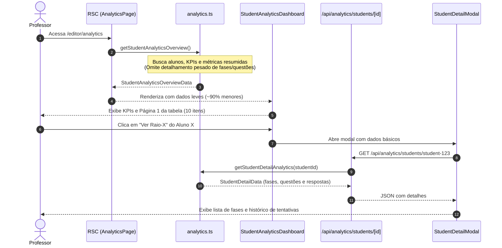

# [SPEC-009] Otimização de Performance, Paginação e Lazy Loading no Analytics dos Estudantes

- **Autor(es):** Equipe Lógica Dinâmica
- **Status:** Proposto / Em Especificação (v2.10.0)
- **Data de Criação:** 2026-10-18
- **Target Release / Milestone:** v2.10.0

---

## 1. Visão Geral & Motivação

### 1.1 Contexto e Diagnóstico do Problema
Na versão v2.9.0 ([SPEC-007](file:///docs/specs/analytics-spec.md)), a rota `/editor/analytics` foi migrada para um modelo centrado no estudante, exibindo métricas individuais de progresso, repetições, erros e um modal de **"Raio-X do Estudante"** detalhando fase a fase e questão por questão.

No entanto, à medida que mais estudantes interagem com o sistema e submetem tentativas (corretas e incorretas), a página passou a apresentar lentidão progressiva no carregamento inicial.

A investigação da arquitetura identificou três causas-raiz:

1. **Eager Loading do Raio-X (Maior Gargalo):**
   A função do servidor `getStudentAnalyticsOverview()` (`src/lib/analytics.ts`) constrói, para **cada estudante**, o array completo de `fases: StudentPhaseDetail[]`, contendo todas as questões ativas com enunciados, contadores de tentativas e respostas brutas em JSON (`ultimaResposta`).
   - Em uma turma com 60 alunos e 30 questões, são mais de **1.800 nós estruturados** gerados e serializados no payload do Next.js (RSC Payload / HTML inicial).
   - O professor só visualiza o Raio-X de **um estudante por vez** ao clicar em *"Ver Raio-X"*. Antecipar esses dados para toda a turma satura desnecessariamente a CPU do servidor, a transferência de rede e a memória do cliente.

2. **Carga Irrestrita de Submissões:**
   A consulta `prisma.submission.findMany({ where: { userId: { in: studentIds } } })` carrega a íntegra de milhares de registros de submissões em memória de uma só vez.

3. **Sobrecarga do DOM:**
   O componente cliente `StudentAnalyticsDashboard.tsx` renderiza todos os alunos simultaneamente em uma única tabela sem paginação, aumentando o tempo de pintura e interação inicial (*Total Blocking Time* e *First Contentful Paint*).

### 1.2 Objetivos (Goals)
- [ ] **Desacoplar o Raio-X da listagem principal (*Lazy Loading*):** A carga inicial do painel deve carregar somente as métricas sumarizadas da tabela. O histórico minucioso de fases e questões deve ser carregado sob demanda apenas quando o professor abrir o modal daquele estudante.
- [ ] **Paginação na Tabela de Estudantes:** Implementar paginação com opções de `10`, `25` e `50` registros por página (padrão: `10`), acompanhada de navegação completa (Anterior, Próximo e números de página).
- [ ] **Busca e Ordenação Instantâneas:** Manter a busca textual (nome/e-mail) e a ordenação por colunas ágeis e sem latência de rede no navegador.
- [ ] **Reset Inteligente de Página:** Ao alterar o filtro de status ou digitar na busca, a paginação deve retornar automaticamente à página 1.
- [ ] **Integridade dos KPIs Gerais:** Os 4 cartões de KPIs do topo (Total de Estudantes, Média de Conclusão, 100% Concluídos, Não Iniciados) devem continuar calculados com base na totalidade da turma matriculada.
- [ ] **Feedback Visual Agradável:** Exibir indicador de carregamento (*skeleton* / *spinner*) ao abrir o Raio-X e controles de paginação responsivos e acessíveis no rodapé da tabela.
- [ ] **Cobertura Completa de Testes (TDD):** Garantir que a suíte Jest/RTL cubra a navegação entre páginas, seletor de limite e o carregamento do modal.

### 1.3 Fora de Escopo (Non-Goals)
- **Paginação Server-Side via Query Params com Recarrecamento de Página:** Para o volume de turmas universitárias (dezenas a centenas de estudantes), a paginação local com payload otimizado (sem Raio-X) é mais rápida, fluida e mantém a busca e a ordenação instantâneas sem idas e vindas ao servidor.
- **Modificação na Lógica Pedagógica:** As regras de cálculo de conclusão, contagem de erros e acertos de primeira definidas na SPEC-007 permanecem 100% inalteradas.

---

## 2. Experiência do Usuário (UX/UI)

### 2.1 Rodapé da Tabela de Estudantes (`StudentAnalyticsDashboard.tsx`)
Abaixo da tabela de estudantes, será adicionada uma barra de controle de paginação alinhada ao design system:

```
┌─────────────────────────────────────────────────────────────────────────────┐
│ [ Tabela com até 10 estudantes ]                                            │
├─────────────────────────────────────────────────────────────────────────────┤
│ Exibir: [ 10 ▾ ] por página  |  Mostrando 1–10 de 54 estudantes             │
│                                           [ < Anterior ] [ 1 ] 2  3 [ Próximo > ] │
└─────────────────────────────────────────────────────────────────────────────┘
```

- **Seletor de Itens por Página:** Dropdown estilizado com as opções `10`, `25` e `50`.
- **Texto Descritivo:** *"Mostrando X–Y de Z estudantes"* (ou *"Nenhum estudante"* quando a busca não retornar resultados).
- **Botões de Navegação:**
  - Botão *"Anterior"* desabilitado (`opacity-40 cursor-not-allowed`) quando `currentPage === 1`.
  - Botão *"Próximo"* desabilitado quando `currentPage === totalPages`.
  - Pílulas numéricas de páginas, com destaque visual (`bg-primary text-white font-bold`) para a página ativa.

### 2.2 Modal de Raio-X com Carga Sob Demanda (`StudentDetailModal.tsx`)
- Ao clicar em *"Ver Raio-X"* ou na linha de um estudante:
  1. O modal abre imediatamente exibindo os dados de cabeçalho do aluno (nome, e-mail, foto, % concluído, total de erros).
  2. Enquanto os dados detalhados das fases estão sendo carregados da API, um esqueleto de carregamento com *shimmer* ou um indicador elegante com ícone `Loader2` animado é exibido.
  3. Ao concluir a requisição (geralmente < 100ms), a árvore de fases e questões é renderizada normalmente.
  4. Um cache em memória no cliente evita requisições redundantes se o professor fechar e reabrir o modal do mesmo aluno durante a mesma sessão.

---

## 3. Arquitetura Técnica & Contratos de Dados



### 3.1 Alterações nos Tipos TypeScript (`src/types/index.ts`)

```typescript
// Resumo do estudante para a tabela principal (leve, sem a árvore de fases)
export interface StudentMetricItem {
  id: string;
  name: string;
  email: string;
  image?: string | null;
  questoesConcluidas: number;
  totalQuestoesAtivas: number;
  porcentagemConcluida: number;
  porcentagemRestante: number;
  totalErros: number;
  acertosDePrimeira: number;
  ultimaAtividade: string | null;
  // 'fases' torna-se opcional na lista para permitir lazy loading
  fases?: StudentPhaseDetail[];
}

// Dados completos retornados pela API exclusiva do Raio-X
export interface StudentDetailData {
  student: {
    id: string;
    name: string;
    email: string;
    image?: string | null;
    questoesConcluidas: number;
    totalQuestoesAtivas: number;
    porcentagemConcluida: number;
    porcentagemRestante: number;
    totalErros: number;
    acertosDePrimeira: number;
    ultimaAtividade: string | null;
  };
  fases: StudentPhaseDetail[];
}
```

### 3.2 Otimização da Função `getStudentAnalyticsOverview()` (`src/lib/analytics.ts`)
- Mantém o cálculo dos KPIs da turma e das métricas das colunas de cada estudante.
- Deixa de instanciar e serializar o objeto `fases` dentro do laço principal de estudantes, eliminando o overhead de milhares de objetos no HTML/RSC.

### 3.3 Nova Função `getStudentDetailAnalytics(studentId: string)` (`src/lib/analytics.ts`)
- Recebe o `studentId`.
- Busca especificamente as fases ativas e as submissões deste estudante.
- Monta o array hierárquico `fases: StudentPhaseDetail[]` apenas para ele.

### 3.4 Nova Rota de API: `GET /api/analytics/students/[id]`
- **Localização:** `src/app/api/analytics/students/[id]/route.ts`
- **Autenticação & RBAC:**
  - Verifica sessão com `getServerSession(authOptions)`.
  - Rejeita com `401 Unauthorized` se não autenticado.
  - Rejeita com `403 Forbidden` se o usuário não possuir papel `Role.TEACHER`.
- **Resposta de Sucesso:** `200 OK` com payload `StudentDetailData`.

---

## 4. Estado da Interface & Lógica de Paginação

### 4.1 Estados Locais em `StudentAnalyticsDashboard.tsx`
```typescript
const [pageSize, setPageSize] = useState<number>(10);
const [currentPage, setCurrentPage] = useState<number>(1);
```

### 4.2 Pipeline de Dados
1. `students`: Array bruto recebido via `initialData.students`.
2. `filteredStudents`: Filtrado por `filterStatus` e `searchTerm`.
3. `sortedStudents`: Ordenado pelo `sortField` e `sortDirection`.
4. `totalPages`: `Math.max(1, Math.ceil(sortedStudents.length / pageSize))`.
5. `paginatedStudents`:
   ```typescript
   const paginatedStudents = useMemo(() => {
     const startIndex = (currentPage - 1) * pageSize;
     return sortedStudents.slice(startIndex, startIndex + pageSize);
   }, [sortedStudents, currentPage, pageSize]);
   ```

### 4.3 Efeito de Reset de Página
Sempre que `searchTerm`, `filterStatus` ou `pageSize` sofrerem alteração, `currentPage` é redefinido para `1` para evitar páginas vazias além do novo limite.

---

## 5. Plano de Implementação (Passo a Passo)

1. **Atualização de Tipos (`src/types/index.ts`):**
   Tornar `fases` opcional em `StudentMetricItem` e declarar `StudentDetailData`.
2. **Camada de Dados (`src/lib/analytics.ts`):**
   - Otimizar `getStudentAnalyticsOverview()` para omitir `fases`.
   - Adicionar `getStudentDetailAnalytics(studentId: string)`.
3. **Endpoint de API (`src/app/api/analytics/students/[id]/route.ts`):**
   Criar rota protegida para fornecer os detalhes do Raio-X por estudante.
4. **Paginação na UI (`StudentAnalyticsDashboard.tsx`):**
   Adicionar seletor de limite (`pageSize`), navegação com botões e corte (`slice`) dos estudantes.
5. **Integração do Modal (`StudentDetailModal.tsx`):**
   Adicionar busca sob demanda e estado de *loading* / *error* ao abrir o modal.
6. **Suíte de Testes Automatizados (TDD):**
   Atualizar e expandir `src/__tests__/StudentAnalytics.test.tsx` com cenários de paginação, troca de página, seletor de quantidade e carregamento sob demanda do Raio-X.
